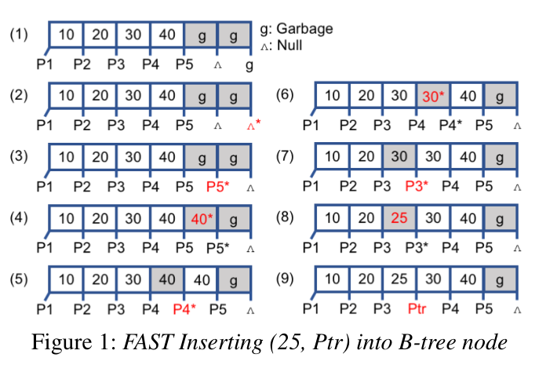
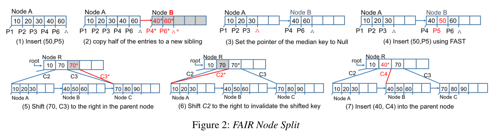
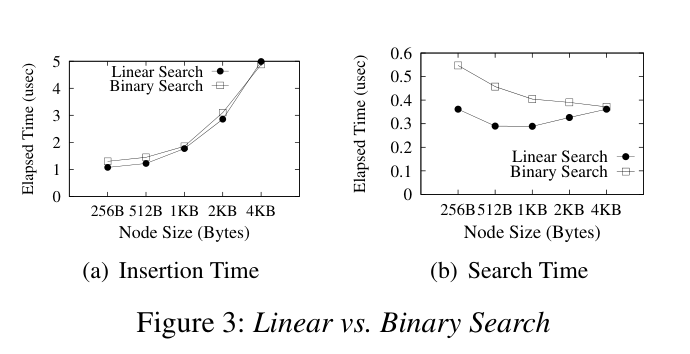
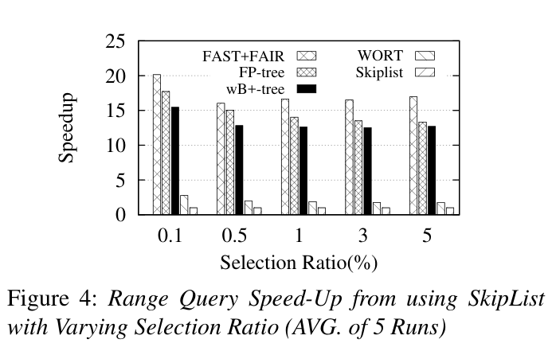
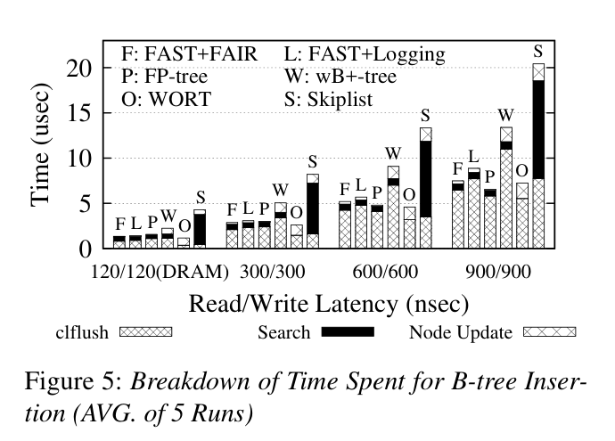
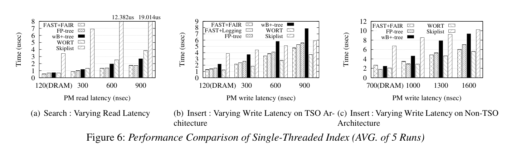
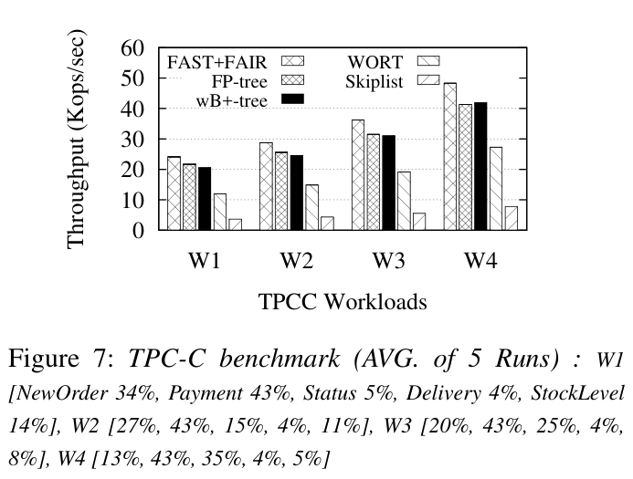
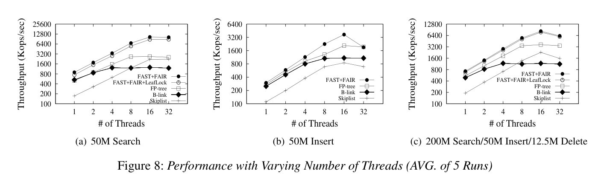

# Figures

8 figures, 0 tables. PDF page = printed page − 185. Crops include original captions; full pages are retained in `pages/`.

## Figure 1 — PDF p.4 / printed p.189

**Caption:** FAST Inserting (25, Ptr) into B-tree node

**Context:** §3.2–3.3：重复指针使尚未完成的键更新可被读取识别并忽略。

## Figure 2 — PDF p.6 / printed p.191

**Caption:** FAIR Node Split

**Context:** §4.1：先持久化兄弟节点，再发布 sibling pointer，最后截断原节点并更新父节点。

## Figure 3 — PDF p.10 / printed p.195

**Caption:** Linear vs. Binary Search

**Context:** §6.2：节点大小与线性/二分查找、插入开销的权衡。

## Figure 4 — PDF p.10 / printed p.195

**Caption:** Range Query Speed-Up from using SkipList with Varying Selection Ratio (AVG. of 5 Runs)

**Context:** §6.3：相对 SkipList 的范围查询加速，横轴为选择率。

## Figure 5 — PDF p.10 / printed p.195

**Caption:** Breakdown of Time Spent for B-tree Insertion (AVG. of 5 Runs)

**Context:** §6.4：分解 clflush、search 和 node update，包含 FAST+Logging 消融。

## Figure 6 — PDF p.11 / printed p.196

**Caption:** Performance Comparison of Single-Threaded Index (AVG. of 5 Runs)

**Context:** §6.4–6.5：(a) 读延迟、(b) TSO 写延迟、(c) non-TSO 写延迟。

## Figure 7 — PDF p.12 / printed p.197

**Caption:** TPC-C benchmark (AVG. of 5 Runs)

**Context:** §6.6：W1–W4 改变事务类型配比；完整配比保留在图片中。

## Figure 8 — PDF p.13 / printed p.198

**Caption:** Performance with Varying Number of Threads (AVG. of 5 Runs)

**Context:** §6.7：search、insert、mixed 随线程数变化；注意隔离语义和编译设置。
